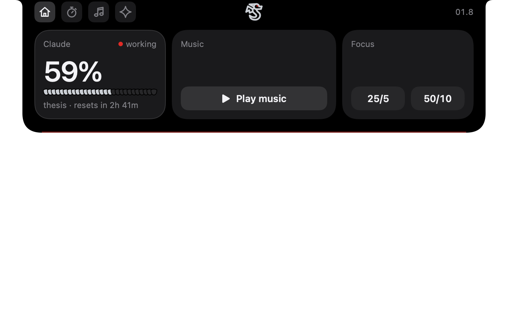
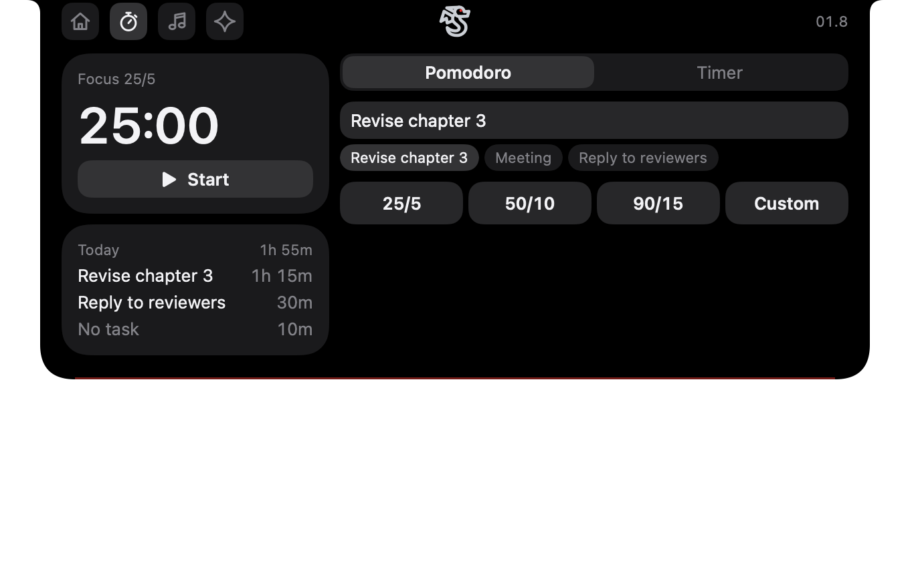
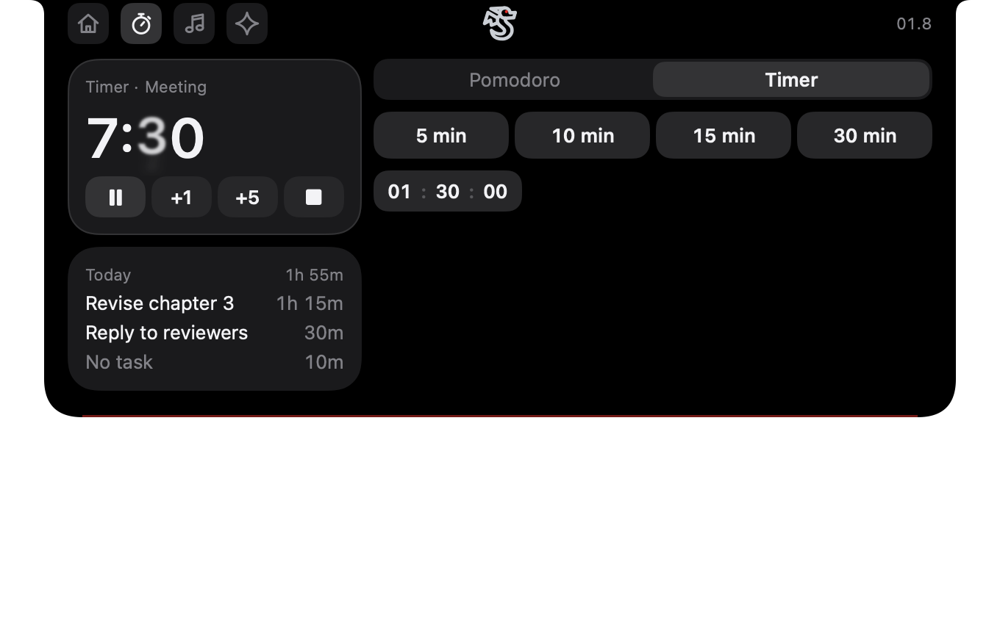
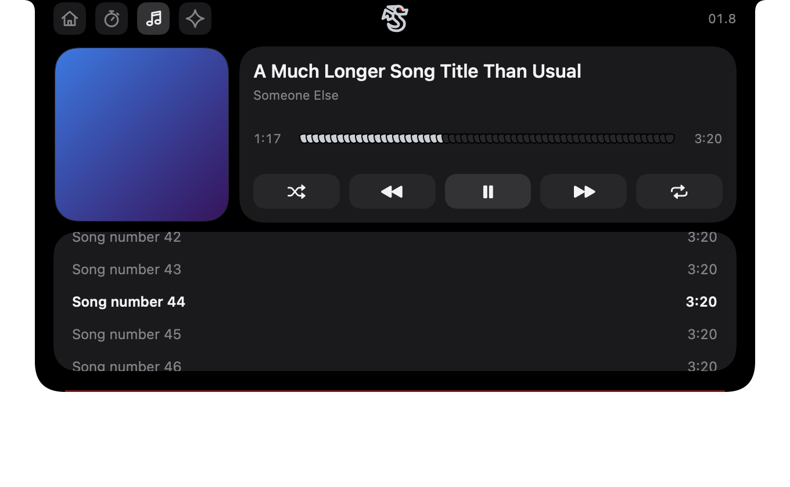
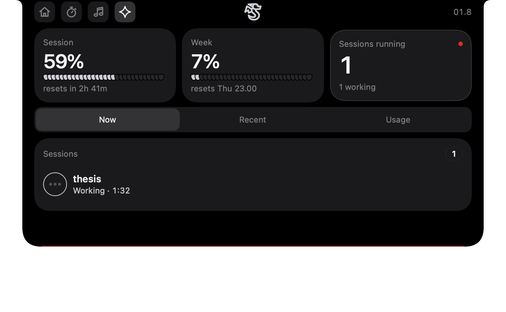
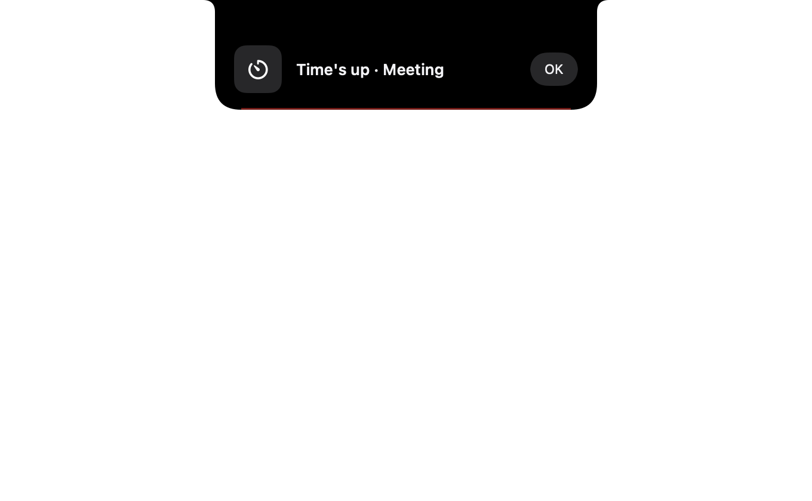

# Wyrmwatch

**Guarding your focus, your music, and your AI agents, right from the notch.**

Wyrmwatch is a macOS notch app: a Pomodoro and a timer with task names, what's playing (Apple Music, Spotify, your browser…), and your Claude Code sessions and usage limits, all in the camera notch.

| | |
|---|---|
|  |  |
|  |  |
|  |  |

## In the notch

Hover the notch (or click it) to open it. The header is split by the camera: four small tabs on the left (Home, Focus, Music, Claude), the time on the right, and in between, where the camera sits, the Wyrmwatch mascot. The notch grows to fit each tab. Right-click the notch for **Settings** and **Quit**.

- **Home**: three cards of the same height, one big number each.
  - **Claude**: your session limit, whether Claude is working (a slowly pulsing red dot) or waiting for you, and what it is doing right now ("Editing HomePage.swift"), with when the limit resets.
  - **Music**: the cover, title and artist, progress, and previous / play-pause / next. Nothing playing? A **Play music** button.
  - **Focus**: the time left with pause and stop, or the 25/5 and 50/10 presets when no timer runs.
- **Focus** has two modes:
  - **Pomodoro**, for long, repeated focus with breaks: presets 25/5, 50/10 and 90/15, or Custom (focus 1–180 min, break 1–60, long break and number of sessions your choice). It keeps time through sleep and restarts, starts each break by itself and plays a short alarm when a phase ends.
  - **Timer**, for one short task that isn't a focus session ("Meeting"): one run, no breaks. Any length to the second (type it or scroll over the numbers), presets 5/10/15/30 min, and +1 / +5 min while it runs. When it ends: a sound, a notification or a card with its name.
  - Both ask **"What are you working on?"**, with your last five task names one click away. The name shows on the time card (click it to rename), in the live notch and on the done card ("Focus done · Revise chapter 3"). **Today** lists every task with its minutes; the log stays on your Mac for 30 days.
- **Music**: a large cover, the song with its progress and controls, and the library playlist being played (click a song to play it). Apple Music gets shuffle, repeat and the playlist; any other player (Spotify, a browser, Podcasts…) shows its song, cover and progress with play-pause, previous, next and seek.
- **Claude**: session limit, week limit and sessions running as big numbers, then Now (running sessions, click to jump to their terminal), Recent (click to resume) and Usage (tokens).

When it's closed, the notch shows what matters in a slim "live" strip: the mascot while Claude works or waits, the cover and a visualizer while music plays, the time left with a small ring during a Pomodoro, taking turns with the task name (and with the music every 6 seconds). Short cards drop out of it when a Claude session finishes, a timer ends or the song changes.

On a screen without a notch (an external monitor), the app draws one: a small black pill at the top that opens the same way. Display modes are Auto, Notch, Menu bar and All screens. In Menu bar mode the app lives in a popover under a menu bar icon instead.

The look is black with #1C1C1E cards, five text sizes and a 4 pt grid. Three things are its own:

- **Ember Edge**: while Claude works, the bottom edge of the notch is a thin red line with an ember drifting along it; while Claude waits for you it pulses white. Idle, there's nothing.
- **The wyrm in its nest**: the mascot in the camera gap and on the left of the live notch. It sleeps, peeks at your pointer, works, looks up when Claude needs you, and breathes a short burst of fire when a session is done.
- **Scale bars**: every progress bar is a row of small overlapping scales that light up one by one.

The only colour is red (#E5322B), and only for signals: Claude working, usage above 90%, the Ember Edge, the wyrm's eye and fire. Repeating animations run in Core Animation, so the app does no work per frame. Nothing animates unless it's on screen, and Reduce Motion (or Settings → System → Always reduce motion) turns all repeating animation off. See [docs/DESIGN-REVIEW.md](docs/DESIGN-REVIEW.md) for the design critique.

## Claude in the background

- **A sound when Claude finishes**, plus a notification, so you can look away while it works.
- **Limit alerts**: a heads-up when your session or weekly limit passes 80% (adjustable), and a ping the moment your session limit resets.
- **Limit forecast**: where you're heading at your current pace ("At this pace, full at 15.40"), from the last 30 minutes.

## Requirements

- macOS 14 or later (built and tested on an M2 MacBook)
- [Claude Code](https://claude.com/claude-code), logged in with a Claude subscription
- Xcode Command Line Tools (`xcode-select --install`)
- [CMake](https://cmake.org), to build mediaremote-adapter (optional: without it the app only reads Apple Music)

## Install

```bash
git clone https://github.com/Saidill/Wyrmwatch.git
cd Wyrmwatch
./scripts/build-app.sh
cp -R Wyrmwatch.app /Applications/
open /Applications/Wyrmwatch.app
```

Then click the ring in the menu bar → ⚙ → turn on **Open at login**. From then on it starts by itself.

If you change the code later, run `./scripts/build-app.sh --install`. It rebuilds the app, replaces the copy in `/Applications` and relaunches it.

While you're working on it, run `./scripts/dev.sh` and leave it open: every time you save a file in `Sources/`, the app rebuilds and relaunches by itself, so you never have to quit and reopen it.

To check that everything still works after a change, run the self-test. It switches between the menu bar and the notch, opens every tab on the real and on a virtual notch, checks that no view overlaps another and that the notch follows each tab's height, runs the Pomodoro, Music and Info modules on made-up data, and saves a picture of every screen plus a `report.txt` to the folder you give it:

```bash
./scripts/build-app.sh && ./Wyrmwatch.app/Contents/MacOS/Wyrmwatch --selftest /tmp/wyrmwatch-test
```

## How it works

Everything is read from files Claude Code already writes on your Mac, and from Music.app. Nothing is sent anywhere, apart from one request for your Claude plan limits.

| What | Where it comes from |
| --- | --- |
| Sessions and the finish sound | `~/.claude/sessions/*.json`. Each running session has a `status`, and a change from `busy` to anything else means Claude finished. Checked every second. |
| Token counts | `~/.claude/projects/**/*.jsonl` transcripts. Only new lines are read, every 2 seconds. |
| Plan limits and alerts | `GET https://api.anthropic.com/api/oauth/usage`, using the login token Claude Code keeps in your Keychain. Refreshed every minute and when you open the popover. When the token expires (after about 8 hours without Claude Code running), the app renews it and saves it back, so Claude Code stays logged in. |
| Recent sessions | The newest transcripts in `~/.claude/projects`. Only the last 64 KB of each file is read, for its title and folder. |
| Jump to session | Finds the app that owns the session's process. For Terminal and iTerm2 it selects the tab by its TTY using AppleScript; macOS asks once for permission. |
| Apple Music | Song changes and play/pause come from the system notification Music posts (`com.apple.Music.playerInfo`). The cover, position, playlist, favourite and controls use AppleScript, never while Music is closed; macOS asks once for permission. Radio and catalog songs outside your library have no readable playlist. |
| Other players | [mediaremote-adapter](https://github.com/ungive/mediaremote-adapter) runs inside `/usr/bin/perl` (since macOS 15.4 only Apple-signed processes may read what's playing) and streams changes as JSON lines. No permission needed, no polling. |
| Task log | Minutes per task per day, in the app's own settings on your Mac, kept for 30 days. |
| Next calendar event | EventKit, after you allow calendar access. Refused? It simply doesn't show. |

The plan-limits endpoint is **unofficial**: it's the same one Claude Code's `/usage` command uses, and Anthropic may change it. If it stops working, the app says so and everything else keeps working.

The Session and Week limits are shared, so they include your chats on claude.ai and in the Claude desktop app. Token counts cover Claude Code only, because chats aren't saved on your Mac.

## Project layout

```
Sources/Wyrmwatch/
  App/            entry point, display modes, menu bar icon, self-test, --diagnose, --perf, --render-icon
  Core/           NotchModule protocol, module registry, priority resolver, pop queue, layout probe
  Notch/          notch window and shape, virtual notch, open panel (header, tabs, Home page)
  Modules/
    Claude/       sessions, usage, plan limits, notifications, jump/resume
    Pomodoro/     timer, task log, Focus page, phase ring and dots
    Music/        Music.app bridge, mediaremote-adapter client, artwork cache, Music page, playlist
    Info/         next calendar event
  Views/          design tokens and motion, the mascot (WyrmSlot, WyrmArt), Ember Edge, shared controls, popover, settings
Vendor/
  mediaremote-adapter/  v0.7.7, BSD 3-Clause
assets/candidates/      mascot candidates and their licences
scripts/
  build-app.sh    builds Wyrmwatch.app (with the Rive runtime, mediaremote-adapter and app icon); --install puts it in /Applications
  measure-perf.sh CPU and memory per notch state
  dev.sh          rebuild and relaunch on every save
```

## Development

```bash
swift build                 # compile
./scripts/build-app.sh      # build the .app bundle
```

No Xcode project is needed. It's a plain Swift package.

## The mascot

Until there's a final one, the mascot is the Tabler "dragon" icon redrawn as separate Core Animation layers (wing, body, head, crest, jaw, eye), so each part moves on its own: the eye blinks, the head turns to the pointer on a spring, and the jaw opens with a burst of fire on "done".

When `Resources/wyrm.riv` is present, the slot plays it with [Rive](https://rive.app) (`RiveRuntime`, about 14 MB in the app) instead. Its state machine gets one boolean input per state (`hidden`, `peek`, `working`, `alert`, `done`, `sleep`) and the numbers `lookX` / `lookY` for where the pointer is.

Other candidates, with their licences, are in [assets/candidates](assets/candidates/README.md). The ones that need a login to download:

- Rive Community, search "dragon": https://rive.app/community/files?search=dragon
- LottieFiles, search "dragon": https://lottiefiles.com/search?q=dragon

## Credits

- Mascot: [Tabler Icons](https://tabler.io/icons) "dragon", MIT licence, © Paweł Kuna.
- Now playing from other apps: [mediaremote-adapter](https://github.com/ungive/mediaremote-adapter) by Jonas van den Berg and contributors, BSD 3-Clause licence (see `Vendor/mediaremote-adapter/LICENSE`, also shipped in the app as `mediaremote-adapter-LICENSE`).
- Mascot runtime: [Rive](https://github.com/rive-app/rive-ios), MIT licence.
