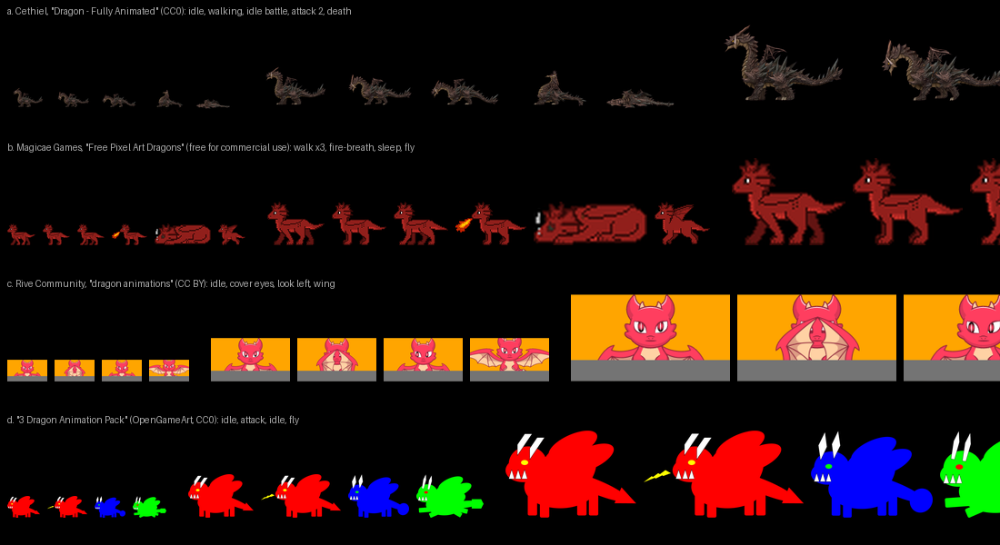
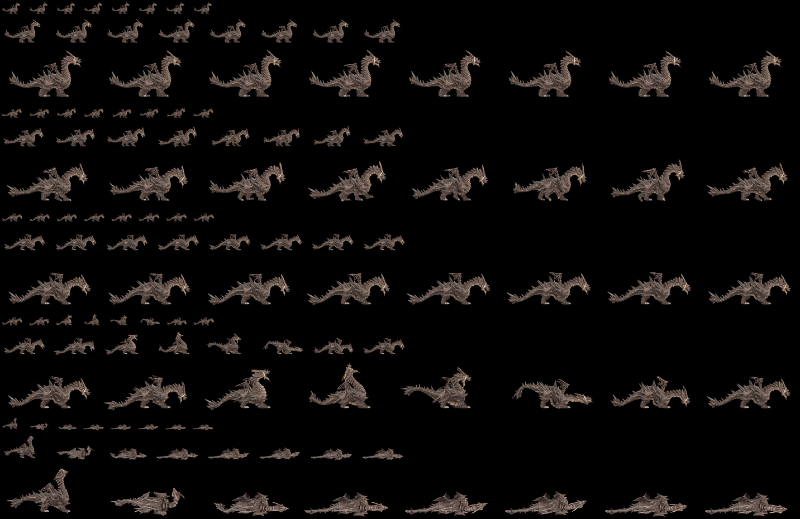

# Maskot: naga animasi

16 November 2026. Empat kandidat diunduh tanpa login ke `~/Downloads/wyrmwatch-dragons/` (file asli tidak di-commit), dirender di ukuran notch (24 dan 48 px) dan 96 px di atas hitam, lalu dilihat.

## Pilihan: "Dragon - Fully Animated" oleh Cethiel (CC0)

https://opengameart.org/content/dragon-fully-animated

Alasannya, menurut urutan kriteria:

1. **Gerakan.** Satu-satunya kandidat dengan animasi yang benar-benar halus: 62–301 frame per animasi pada 60 fps (render 3D). Tiga kandidat lain punya 2–4 frame per gerakan, atau bukan animasi karakter.
2. **Terbaca di 24–48 px.** Siluetnya (leher, tanduk, duri punggung, ekor panjang) tetap jelas di 24 px. Render aslinya terlalu gelap untuk notch hitam, jadi saat dipaketkan dicerahkan sedikit (gamma 0,75, gain 1,15). Bentuk dan warnanya tidak diubah.
3. **Pemetaan state.** Idle, Idle Battle, Walking, Attack, Hurt dan Death cukup untuk semua state (tabel di bawah). Yang tidak ada: api. "Done" memakai gerakan berdiri lalu menerkam.
4. **Gaya.** Dark fantasy, tidak kekanak-kanakan: sisik cokelat abu, perut warna tulang, duri abu kebiruan, mata kuning amber.

Kekurangannya, apa adanya:

- Tidak ada animasi tidur, bangun, atau mengaum di versi gratis (itu ada di versi HD berbayar di Patreon pembuatnya). Tidur dibuat dari akhir animasi Death (naga rebah lalu diam) dan bangun dari animasi yang sama diputar mundur. Di 24 px ini terbaca sebagai "rebah", tapi tetap animasi mati, bukan tidur.
- Tidak ada api. Kalau api wajib, yang punya hanya kandidat b, dengan 3 frame yang kaku.
- Bentuknya lebar (1,8 : 1). Di notch live ia 43 × 24 pt, dan di header sekarang hanya ±20 pt tinggi karena dibatasi tinggi notch.

## Perbandingan

| | a. Cethiel | b. Magicae Games | c. Rive "dragon animations" | d. 3 Dragon Animation Pack |
| --- | --- | --- | --- | --- |
| Sumber | [OpenGameArt](https://opengameart.org/content/dragon-fully-animated) | [itch.io](https://magicae-games.itch.io/free-pixel-art-dragons) | [Rive Community](https://rive.app/community/files/8743-16725-dragon-animations/) | [OpenGameArt](https://opengameart.org/node/132480) |
| Lisensi | CC0 | Bebas komersial dan boleh diubah, tidak boleh dijual ulang | CC BY 4.0 (ahmada-PHPFG) | CC0 |
| Unduh tanpa login | Ya (zip 133 MB) | Ya (bayar seikhlasnya, bisa 0) | Ya (file `.riv` 63 KB) | Ya |
| Format | PNG per frame, 725 × 445 | Satu sheet 1360 × 512, sel ±113 × 64 | Rive, 1 artboard, 9 animasi | PNG per frame |
| 1. Gerakan | **60 fps, 62–301 frame per animasi** | 3 frame per gerakan, kaku | Halus (vektor), tapi hanya gerakan maskot form login | 2–4 frame per gerakan |
| 2. Terbaca di 24–48 px | Ya, setelah dicerahkan | Ya, piksel besar dan warna terang | Tidak: kotak oranye dengan meja abu, naganya terpotong | Ya, tapi warna polos |
| 3. State | Idle, Idle Battle, Walking, Attack 1–2, Hurt, Death. Tidak ada tidur dan api | **Paling lengkap**: Walk, Run, Fire-breath, Fly, Sit, Sleep, Flap, Dance | Idle, lihat kiri/kanan, tutup mata, kepak sayap. Tidak ada kerja, tidur, api | Idle, Fly, Attack, Die |
| 4. Gaya | **Dark fantasy** | Gaya RPG Maker, agak lucu | Kartun imut, latar oranye menyatu di file | Kartun polos, warna primer |
| Hasil | **Dipilih** | Kalah di kriteria 1 | Kalah di kriteria 2, 3 dan 4 | Kalah di kriteria 1 dan 4 |

Kandidat ikon statis yang lama (Tabler, Game Icons, dll.) tetap ada di `assets/candidates/`.

## Pemetaan state

Urutan di gambar: idle, working, alert, done, sleep.

| State | Kapan | Animasi asli | Frame (30 fps) | Putar |
| --- | --- | --- | --- | --- |
| peek / idle | Tidak ada apa-apa | Idle | 80 | Berulang |
| working | Claude bekerja | Walking | 81 | Berulang |
| alert | Claude menunggu saya | Idle Battle (merunduk, siaga) | 70 | Berulang |
| done | Sesi selesai | Attack 2 (berdiri lalu menerkam) | 102 | Sekali, lalu kembali ke idle |
| sleep | Tidak ada input 5 menit | Death frame 127–301 (rebah) | 88 | Sekali, berhenti di frame terakhir, lalu "bernapas" pelan (skala vertikal 1 → 1,05) |
| wake | Keluar dari sleep | Sheet sleep diputar mundur, 1,6× | 88 | Sekali, lalu animasi state berikutnya |

## Cara pasang

- `scripts/make-dragon-atlas.py` (butuh Pillow) memotong semua frame dengan kotak yang sama (supaya naga berdiri di titik yang sama di semua animasi), mengambil tiap frame kedua (60 → 30 fps), mengecilkan ke tinggi 96 px (2× dari 48 pt), mencerahkan, membalik supaya menghadap kanan, lalu menyusunnya jadi satu grid per animasi dengan 256 warna.
- Hasil di `Resources/Dragon/`: `idle.png`, `working.png`, `alert.png`, `done.png`, `sleep.png` dan `dragon.json` (ukuran frame, kolom, baris, jumlah frame, fps, loop). Total **±1 MB** (batas 5 MB).
- `Views/DragonSpriteView.swift`: satu `CALayer`. Frame berganti lewat `CAKeyframeAnimation` (mode diskret) pada `contentsRect`, jadi yang bekerja render server, bukan SwiftUI. Sheet baru di-decode saat pertama kali diputar.
- Pindah state: crossfade 150 ms (`CATransition`). "Done" sekali lalu idle. Saat notch tertutup atau Reduce Motion aktif, semua animasi dilepas dan yang tampil satu frame diam.
- Rive tidak dipakai lagi, jadi `RiveRuntime` (14 MB) dilepas dari app. App turun dari ±21 MB ke 6,9 MB.
- Kredit: README dan panel About (klik kanan notch → About Wyrmwatch). CC0 tidak mewajibkan atribusi, tapi tetap ditulis.
