# Tiga arah desain

**Keputusan (16 November 2026): Hearth dipilih dan sudah diterapkan ke seluruh app** (`feat/hearth-design`), dengan dua perubahan yang disebut di Rekomendasi. Kritik setelah penerapan ada di `docs/DESIGN-REVIEW.md`, ronde 4. Halaman ini catatan perbandingannya; prototipe Obsidian dan Vault serta flag `--design` sudah dihapus dari kode (masih ada di branch `design/directions`).

Saat dibandingkan, ketiganya hanya prototipe untuk tab Home dan Focus. Tab Music dan Claude, notch live, pop, popover menu bar, dan Settings belum disentuh.

Screenshot dibuat oleh app sendiri (`--selftest <folder> --only directions`) dengan data tiruan yang sama untuk semua arah: Claude bekerja, satu lagu diputar, sesi 24%, tiga tugas hari ini. Reduce Motion dipaksa aktif supaya gambarnya bisa dibandingkan, jadi naganya diam di gambar.

Yang sama di ketiga arah:

- **Hitam tetap dominan.** Ungu gelap hanya dipakai untuk permukaan dan garis (`#100D15`–`#3A3346`), tidak pernah untuk teks atau isi.
- **Satu aksen: amber mata naga `#F0A22B`.** Hanya untuk yang sedang berjalan: titik "working", tepi kartu yang aktif, bar timer yang berjalan, dan Ember Edge. Merah tidak dipakai lagi.
- **Teks warna tulang** (`#F1EDE6`), diambil dari perut dan tanduk naga, menggantikan putih kebiruan.
- **Scale bar tetap**, sisik terisi berwarna tulang.
- **Naga keluar dari celah kamera.** Self-test memeriksa bahwa naga tidak menyentuh area kamera di notch Mac ini.
- Layout tiap tab, fitur, dan Settings tidak berubah.

`current-*.png` adalah desain sekarang dengan perbaikan bug saja, sebagai pembanding.

## 1. Obsidian

**Lempeng batu vulkanik yang dipotong: sudut terpangkas, satu tepi yang terkena cahaya.**

| Home | Focus |
| --- | --- |
| 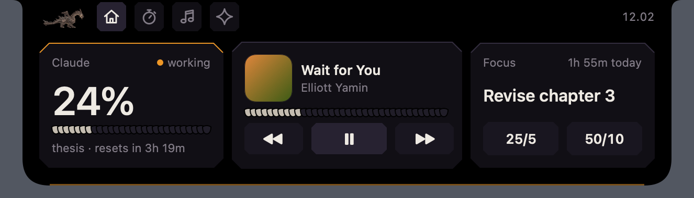 | 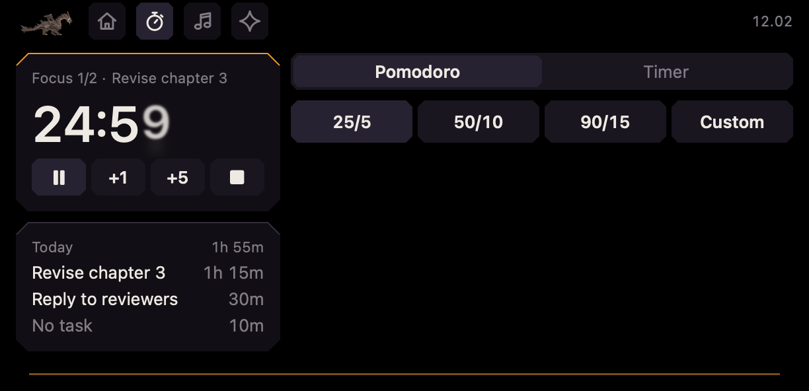 |
| 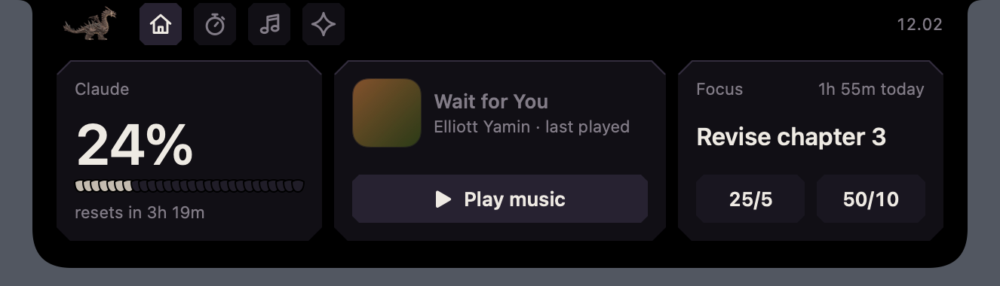 | 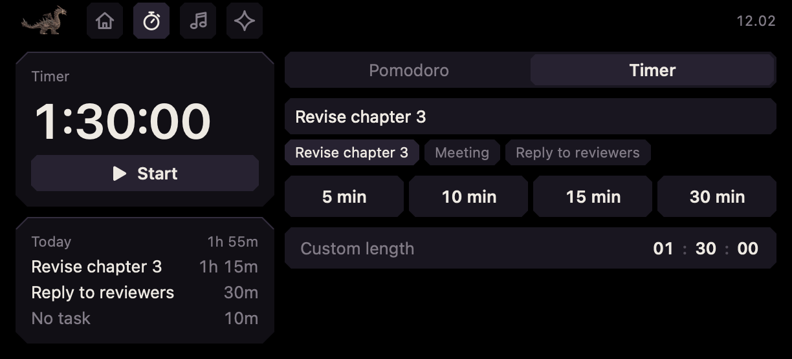 |

Keputusan: (1) semua sudut dipangkas lurus, tidak ada lengkung selain notch; (2) permukaan rata hitam keunguan; (3) cahaya hanya di tepi atas tiap lempeng, amber kalau aktif. Naga 26 pt di kiri tab.

Kelebihan
- Siluetnya langsung beda dari widget iOS, hanya dengan satu aturan bentuk.
- Tepi atas amber jelas menunjukkan kartu mana yang aktif, tanpa glow.
- Paling murah diterapkan ke tab lain: bentuk dan warna saja.

Kekurangan
- Sudut terpangkas di tombol kecil (tab, chip) mulai terasa seperti HUD game sci-fi. Ini yang paling dekat ke "norak".
- Tetap kisi kartu yang sama. Yang berubah kostumnya, bukan rasanya.
- Naga paling kecil di sini (26 pt) dan tidak punya hubungan dengan elemen lain: ia hanya ikon di sebelah tab.
- Cover album tetap membulat, jadi satu-satunya lengkung di layar.

Cek anti-slop: grid 4 pt ya · 5 ukuran huruf ya · satu elemen utama per kartu ya · tanpa gradient ya · tanpa glow ya · tanpa emoji dan teks dekoratif ya.

## 2. Hearth

**Tanpa kotak: garis tipis dan huruf di atas hitam, naga berjalan di garis tanah di bawah header.**

| Home | Focus |
| --- | --- |
| 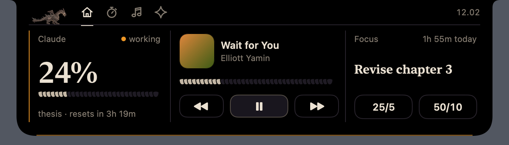 | 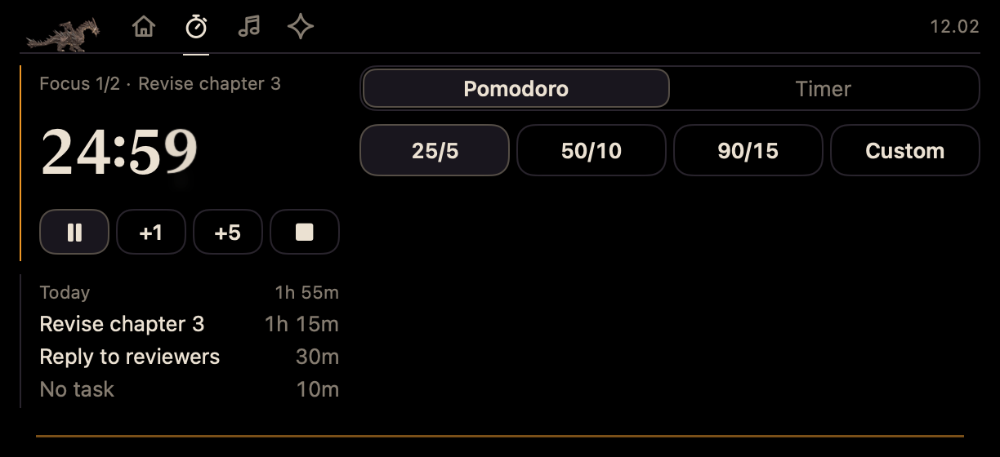 |
| 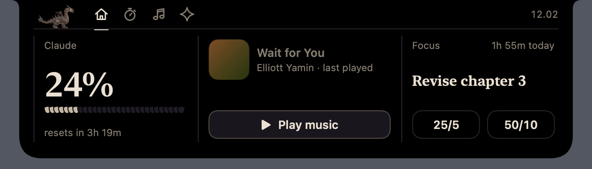 | 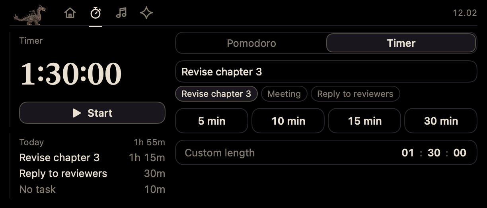 |

Keputusan: (1) kartu tidak punya latar, hanya satu garis di tepi kiri tiap blok (amber kalau aktif); (2) tombol berupa garis luar, baru terisi saat aktif; (3) angka dan judul memakai serif sistem (New York), label tetap SF. Naga 30 pt di kiri, berdiri di garis tanah selebar panel. Tab tanpa kotak, tab aktif ditandai garis pendek di garis tanah.

Kelebihan
- Paling jauh dari "widget iOS generik", karena kotaknya memang hilang. Layarnya terasa satu halaman, bukan tiga widget.
- Naga punya dunia: ia berdiri di sesuatu, dan garis itu sekaligus pemisah header.
- Angka serif memberi rasa lama tanpa hiasan apa pun.
- Hiasan paling sedikit dari ketiganya: tidak ada isi latar, gradient, atau bayangan sama sekali.

Kekurangan
- Tombol garis luar yang banyak (halaman Focus punya ±12) bisa terasa seperti wireframe. Segmented Pomodoro | Timer jadi garis di dalam garis.
- Dua keluarga huruf. Masih 5 ukuran, tapi ini keputusan tambahan yang harus dijaga konsisten.
- Garis `#2E2833` di atas hitam kontrasnya rendah. Di layar redup bisa hilang, dan blok jadi tidak terpisah.
- Padding blok 4 pt (atas/bawah) dan 12 pt (kiri) tidak sama dengan kartu lain yang 12 pt. Masih di grid 4 pt.
- Cover album jadi satu-satunya bidang berwarna penuh, cukup mencolok.

Cek anti-slop: grid 4 pt ya (garis tanah digeser 1 pt) · 5 ukuran huruf ya, tapi 2 keluarga · satu elemen utama per kartu ya · tanpa gradient ya · tanpa glow ya · tanpa emoji dan teks dekoratif ya.

## 3. Vault

**Pelat yang timbul dan sumur yang tenggelam: lembut dan berat, yang aktif naik dan menghangat. Naga bertengger di tepi kartu.**

| Home | Focus |
| --- | --- |
| 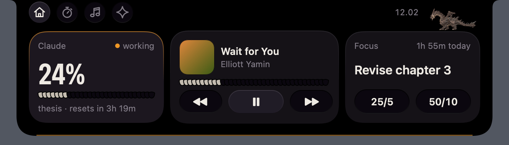 | 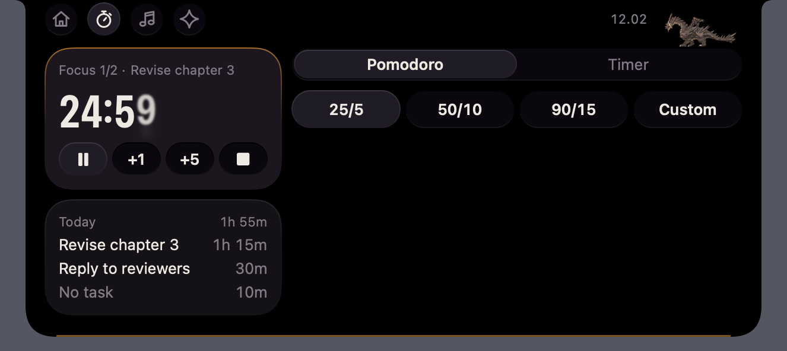 |
| 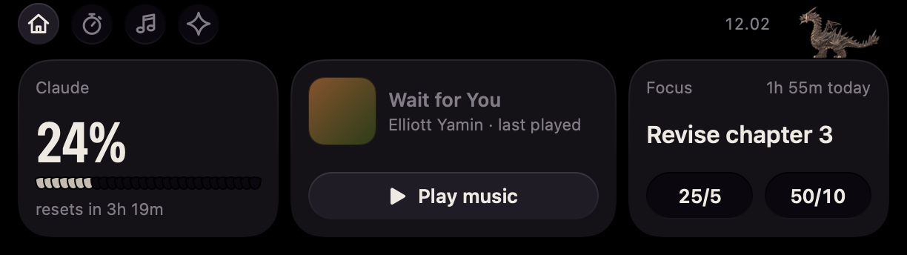 | 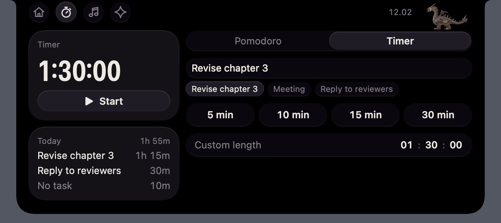 |

Keputusan: (1) dua kedalaman: kartu timbul (tepi atas terang 1 pt), tombol tenggelam (lebih gelap dari kartu, tepi atas gelap), dan yang aktif timbul lagi; (2) tombol bulat penuh; (3) angka utama condensed. Naga 40 pt di kanan, menghadap ke dalam, kakinya di tepi atas kartu terakhir.

Kelebihan
- Menjawab langsung "semua permukaan rata": sekarang ada tiga tingkat kedalaman yang punya arti (tenggelam = bisa ditekan, timbul = aktif).
- Naga paling besar dan paling jelas di sini (40 pt), dan ia menyentuh UI-nya.
- Paling aman: struktur kartu yang sudah teruji tetap ada.
- Scale bar paling bagus di sini, karena sisik kosongnya tenggelam ke dalam kartu.

Kekurangan
- Paling mirip desain sekarang. Kartu membulat dengan tombol pil masih bisa terbaca sebagai widget iOS, hanya lebih gelap.
- Tepi terang-gelap memakai gradient pada garis 1 pt. Kecil dan statis, tapi ini satu-satunya gradient di ketiga arah.
- Naga menimpa 8 pt celah di atas kartu. Di tab Focus yang di bawahnya bukan kartu, melainkan segmented Pomodoro | Timer, jadi "bertengger"-nya kurang masuk akal di sana.
- Posisi naga tidak di grid 4 pt (digeser 3 pt supaya kakinya pas di tepi kartu).
- Angka condensed sedikit lebih sulit dibaca sekilas daripada SF biasa.

Cek anti-slop: grid 4 pt ya, kecuali geseran naga · 5 ukuran huruf ya · satu elemen utama per kartu ya · gradient hanya di garis 1 pt · tanpa glow ya · tanpa emoji dan teks dekoratif ya.

## Rekomendasi

**Hearth.** Masalah yang disebut adalah "terasa seperti widget iOS generik, semua permukaan rata, tidak ada atmosfer". Hanya Hearth yang membuang penyebabnya (kisi kartu membulat), bukan mendandaninya. Ia juga yang paling sedikit hiasannya, dan satu-satunya yang memberi naga tempat berdiri.

Dua hal yang akan saya ubah saat menerapkannya:

1. Tombol utama tiap blok (Start, play/pause) terisi warna tulang redup, sisanya tetap garis luar. Ini mengurangi kesan wireframe dan memberi satu aksi yang jelas per blok.
2. Garis dinaikkan satu tingkat kontrasnya, lalu dicek di kecerahan layar rendah.

Kalau Hearth terasa terlalu sepi, pilihan kedua saya **Vault**: paling rapi dan naganya paling menonjol, tapi perubahannya paling kecil. **Obsidian** saya taruh terakhir karena risikonya norak paling besar dan naganya paling tidak mendapat tempat.

Bisa juga digabung: misalnya Hearth dengan naga 40 pt milik Vault. Sebutkan saja.

## Bug

Sudah diperbaiki di branch ini (terlihat di semua arah dan di `current-*.png`):

- **Jam header "01.8".** Penyebabnya bukan terpotong: format menit tanpa dua digit menghilangkan nol di depan pada region Indonesia. Sekarang selalu dua digit.
- **Kartu Music kosong saat idle.** Menampilkan lagu terakhir (diredupkan, "· last played") dan tombol Play music. Judul dan artis disimpan antar-launch; cover hanya selama app berjalan.
- **Kartu Focus kosong saat idle.** Menampilkan tugas terakhir, total hari ini, dan preset 25/5 dan 50/10.
- **Input Timer h:m:s mengambang.** Sekarang satu baris selebar preset: "Custom length" di kiri, jam:menit:detik di kanan.

Belum, karena ada di tab yang belum disentuh. Dikerjakan saat arah yang dipilih diterapkan:

- baris playlist terpotong setengah (tab Music)
- badge "1" duplikat di kartu Sessions (tab Claude)
